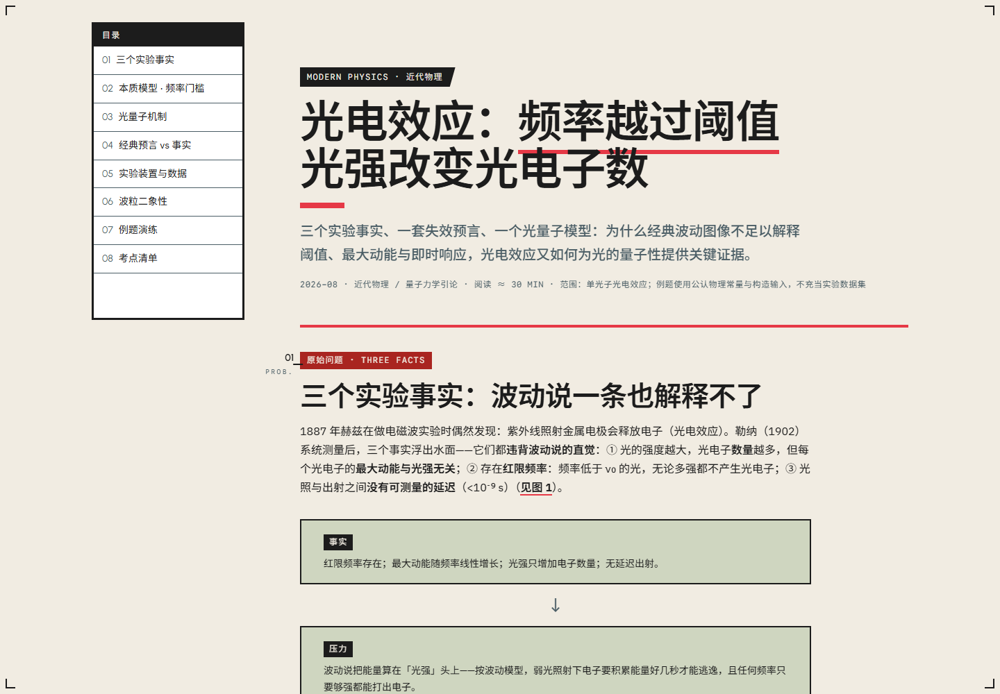

<div align="center">

<p><a href="README.zh-CN.md">简体中文</a></p>

<h1>NOESIS</h1>

<p><strong>Study pages that think with you.</strong></p>

<p>A skill for agents that turns technical topics into single-file HTML lessons<br>
with a causal spine, a tested mental model, and diagrams that earn their place.</p>

<p><sub><em>noēsis · the act of understanding, made visible</em></sub></p>

<p>
  <a href="LICENSE"></a>
  
  
  
</p>

<p>
  <a href="https://htmlpreview.github.io/?https://github.com/Kelinop/noesis-tutorial/blob/main/references/example-kmp.html"></a>
  <a href="#install"></a>
  <a href="#how-it-works"></a>
</p>

</div>

<p align="center">
  <a href="https://htmlpreview.github.io/?https://github.com/Kelinop/noesis-tutorial/blob/main/references/example-kmp.html">
    
  </a>
</p>

<p align="center"><sub><em>KMP / 408 — an exam-dense lesson built as a technical blueprint.</em> · <a href="https://htmlpreview.github.io/?https://github.com/Kelinop/noesis-tutorial/blob/main/references/example-kmp.html">Open the live page →</a></sub></p>

---

## A page should make an argument

Most generated study pages stop at arrangement: a title, some summaries, a few cards, and a diagram added for visual interest.

Noesis starts with a stricter question:

> **What should the learner be able to explain, predict, or do after this page?**

The answer determines everything that follows: the learning contract, the evidence, the mental model, the diagrams, the typography, and the final review.

### Four commitments

- **A causal spine.** Every lesson moves through a real problem, pressure, mechanism, boundary, and consequence. Exam mode adds positioning, derivations, traps, and transfer checks without turning the page into an answer key.
- **Diagrams that reason.** A trace, threshold line, or causal chain is constructed from entities, relations, channels, scales, labels, and boundaries. It is not selected from a component menu and then decorated.
- **Evidence with provenance.** Constructed inputs, measured data, and illustrative examples are distinguished. Units, baselines, uncertainty, and source status survive the visual treatment.
- **An artifact, not a draft.** One portable HTML file, no build step, responsive layout, visible keyboard focus, and complete reading without JavaScript. Google Fonts is an optional enhancement, with readable local fallbacks.

The visual language is **contemporary constructivist technical editorial**: asymmetric hierarchy, material contrast, editorial restraint, and geometry used as an instrument rather than wallpaper.

<a id="live-preview"></a>

## Three visual arguments

The examples are standalone lessons, not screenshots of a fixed template. Each begins from a different information structure and therefore arrives at a different visual system.

| [Maxwell's equations →](https://htmlpreview.github.io/?https://github.com/Kelinop/noesis-tutorial/blob/main/references/example-maxwell-equations.html) | [Photoelectric effect →](https://htmlpreview.github.io/?https://github.com/Kelinop/noesis-tutorial/blob/main/references/example-photoelectric-effect.html) |
|:--:|:--:|
| <a href="https://htmlpreview.github.io/?https://github.com/Kelinop/noesis-tutorial/blob/main/references/example-maxwell-equations.html"></a> | <a href="https://htmlpreview.github.io/?https://github.com/Kelinop/noesis-tutorial/blob/main/references/example-photoelectric-effect.html"></a> |
| A historical arc carried by a timeline, staged derivation, and evidence collage. | A threshold lesson built around a calibrated axis, competing models, and an annotated apparatus. |

<p align="center"><sub><a href="https://htmlpreview.github.io/?https://github.com/Kelinop/noesis-tutorial/blob/main/references/example-kmp.html">01 · KMP / 408</a> · <a href="https://htmlpreview.github.io/?https://github.com/Kelinop/noesis-tutorial/blob/main/references/example-maxwell-equations.html">02 · Maxwell</a> · <a href="https://htmlpreview.github.io/?https://github.com/Kelinop/noesis-tutorial/blob/main/references/example-photoelectric-effect.html">03 · Photoelectric effect</a> — rendered with <a href="https://htmlpreview.github.io/">htmlpreview</a>.</sub></p>

The examples are written in Mandarin Chinese; the delivered page follows the language of the request.

<a id="how-it-works"></a>

## Designed before it is drawn

Noesis does not begin with a layout. It builds the lesson in layers:

```text
learning contract → evidence ledger → tested mental model
→ form selection → diagram construction → responsive HTML
→ four quality gates
```

The page is allowed to look bold only after the underlying work is sound. A diagram must pass the same tests as an argument: can the reader read it, does it imply anything false, does it show the boundary, and can its labels be recovered without the surrounding prose?

### Four gates

| Gate | The question it asks |
|:---|:---|
| **Learning and scope** | Could a specified learner explain, predict, or transfer the model after reading? |
| **Evidence and correctness** | Are claims traceable, scales honest, inputs identified, and code actually run? |
| **Artifact behavior** | Does it parse, navigate, focus, reflow, and read without JavaScript? |
| **Visual and semantic validity** | Does the visual thesis land on the main learning turn, and does every diagram remain truthful? |

<a id="install"></a>

## Install

Noesis is an **Agent Skill**: `SKILL.md` plus optional references and examples. Copy the repository into your agent's skills directory:

```bash
# CodeBuddy (user scope)
cp -r noesis-tutorial ~/.codebuddy/skills/

# Claude Code / Claude Desktop
cp -r noesis-tutorial ~/.claude/skills/

# Cursor, Windsurf, or other agents that read .claude/skills
cp -r noesis-tutorial .claude/skills/
```

Any agent that supports `SKILL.md` plus optional reference files can use it. `visual-language.md` is loaded on demand; examples are read selectively.

<a id="usage"></a>

## Ask for a lesson

The skill activates only when you request a complete learning artifact. A conversational “explain X” stays conversational.

> **“Write a complete HTML study note on TCP congestion control, with diagrams and a practice section.”**
>
> **“Explain how the three-way handshake works, as a standalone HTML learning page.”**
>
> **「写一份虚拟内存的学习笔记，要 HTML 页面。」**

The output is a single HTML file you can open, keep, print, or share.

<details>
<summary><strong>Repository map</strong></summary>

<br>

```text
noesis-tutorial/
├── SKILL.md                        # Activation, learning architecture, workflow, contract, four gates
├── references/
│   ├── visual-language.md          # Aesthetic identity, invariants, form selection, diagram construction, typography, review
│   ├── example-kmp.html            # Exam-dense / blueprint-led
│   ├── example-maxwell-equations.html  # Historical arc / poster-led
│   └── example-photoelectric-effect.html  # Threshold mechanism / instrument-led
├── assets/                         # README previews
├── README.md                       # This file
├── README.zh-CN.md                 # 简体中文版本
└── LICENSE                         # MIT License
```

**Execution inputs:** `SKILL.md` is always active; load `visual-language.md` before writing CSS, and read only the sections of the closest example.

</details>

---

## License

[MIT](LICENSE) © Kelinop
