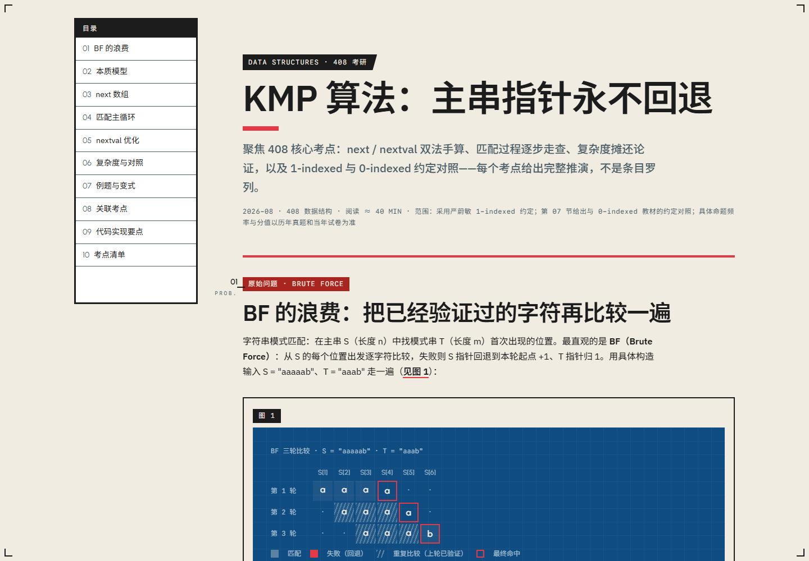

<div align="center">

<pre style="font-family: 'IBM Plex Mono', monospace; line-height: 1.2;">
╔══════════════════════════════════════════════════════════════╗
║                                                              ║
║   ███╗   ██╗ ██████╗ ███████╗███████╗██╗███████╗            ║
║   ████╗  ██║██╔═══██╗██╔════╝██╔════╝██║██╔════╝            ║
║   ██╔██╗ ██║██║   ██║█████╗  ███████╗██║███████╗            ║
║   ██║╚██╗██║██║   ██║██╔══╝  ╚════██║██║╚════██║            ║
║   ██║ ╚████║╚██████╔╝███████╗███████║██║███████║            ║
║   ╚═╝  ╚═══╝ ╚═════╝ ╚══════╝╚══════╝╚═╝╚══════╝            ║
║                                                              ║
║           T U T O R I A L   ·   S K I L L                    ║
║                                                              ║
╚══════════════════════════════════════════════════════════════╝
</pre>

<h3>Turn technical topics into designed engineering knowledge pages</h3>

<p>Complete, runnable HTML learning notes in a <strong>constructivist technical-editorial style</strong>.<br>
Not a textbook dump. Not a Markdown-to-HTML conversion.</p>

<p>
  <a href="LICENSE"></a>
  
  
  
</p>

<p><a href="README.zh-CN.md">简体中文</a> · <a href="#live-preview">Live Preview</a> · <a href="#install">Install</a> · <a href="#usage">Usage</a></p>

<br>

<a href="https://htmlpreview.github.io/?https://github.com/Kelinop/noesis-tutorial/blob/main/references/example-kmp.html">
  
</a>

<p><em>KMP Algorithm: The Main-String Pointer Never Backtracks — <a href="https://htmlpreview.github.io/?https://github.com/Kelinop/noesis-tutorial/blob/main/references/example-kmp.html">open in browser →</a></em></p>

</div>

---

## Live preview

This is what the skill produces. Every example is a standalone HTML file — click to open it in your browser (rendered via [htmlpreview](https://htmlpreview.github.io/)):

| # | Example | Topic | Highlights |
|:---:|:---|:---|:---|
| 01 | [KMP — 408 exam points](https://htmlpreview.github.io/?https://github.com/Kelinop/noesis-tutorial/blob/main/references/example-kmp.html) | KMP 全 408 考点 | Real-data trace, interactive stepper, alignment diagram, archival panels |
| 02 | [Maxwell's equations](https://htmlpreview.github.io/?https://github.com/Kelinop/noesis-tutorial/blob/main/references/example-maxwell-equations.html) | 麦克斯韦方程组 | Poster header, ochre timeline, stair groups, mirrored composition, collage |
| 03 | [Photoelectric effect](https://htmlpreview.github.io/?https://github.com/Kelinop/noesis-tutorial/blob/main/references/example-photoelectric-effect.html) | 光电效应 | Red sun, threshold gauge, stance dialogue, SVG apparatus |

Three examples with maximally different temperaments — exam-dense blueprint, poster-style geometric freedom, and short-verdict dialogue. Each demonstrates the same visual language constructed from a generative grammar, not a component catalog.

## What it produces

| Feature | Description |
|:---|:---|
| **Standalone HTML** | Zero build tools. One external dependency: Google Fonts CDN. Open in any browser. |
| **Causal-chain teaching** | Problem → Pressure → Failed approach → Essence hook → Mechanism (real-data worked examples) → Tradeoff → Definition → System impact |
| **Visual language** | Layer-based color model (L0–L5), 20° axis, plate mounting — a **generative grammar**: a small set of invariants plus a form vocabulary, from which forms are constructed to fit the content |
| **Exam-point depth** | 408 postgrad entrance exams: positioning, derivations, traps, speed tricks, related topics |
| **Quality gate** | Invariant check + semantic-validity self-check before every delivery |

<a name="install"></a>
## Install

This is an **Agent Skill** (`SKILL.md` + `references/`). Copy the repository into your agent's skills directory:

```bash
# Claude Code / Claude Desktop
cp -r noesis-tutorial ~/.claude/skills/

# Cursor, Windsurf, or other agents that read .claude/skills
cp -r noesis-tutorial .claude/skills/
```

Any agent that reads `SKILL.md` can use it — the skill is just rules and examples.

## Activation

The skill auto-activates when a request matches the frontmatter description:

```yaml
name: noesis-tutorial
description: Use only when the user asks for a learning artifact — a complete,
  self-contained HTML learning page (technical tutorial, concept study page,
  learning notes, exam-point review material). Conversational "explain X" / Q&A
  requests do NOT trigger this skill; answer them directly.
  仅当用户明确要求交付 HTML 学习页面时使用；聊天式问答不触发本技能。
```

Or invoke it explicitly by name.

<a name="usage"></a>
## Usage

Ask for a technical topic as a learning page:

> **"Write a complete study note on KMP with full exam points"**
>
> **"Explain how TCP's three-way handshake works, as an HTML page"**
>
> **「写一份虚拟内存的学习笔记，要 HTML 页面」**

The agent runs the **creation workflow** in `SKILL.md`:

```
Research → Causal chain → Essence hook → Semantic orchestration → Form construction → HTML → Self-check
```

Then verifies against the **delivery self-check** (invariants + semantic validity). Pages are standalone — open the HTML directly in a browser.

## Repository layout

```
noesis-tutorial/
├── SKILL.md                        # Workflow: when to use, creation workflow, teaching architecture, self-check
├── references/
│   ├── visual-language.md          # The single visual reference: invariants, generative grammar, form vocabulary
│   ├── example-kmp.html            # Exam-dense / blueprint family
│   ├── example-maxwell-equations.html  # Poster header / geometric freedom
│   └── example-photoelectric-effect.html  # Short verdict / dialogue / instruments
├── README.md                       # This file
├── README.zh-CN.md                 # 简体中文版本
└── LICENSE                         # MIT License
```

**Execution inputs**: `SKILL.md` + `visual-language.md` + three example pages.

---

## License

[MIT](LICENSE) © Kelinop
